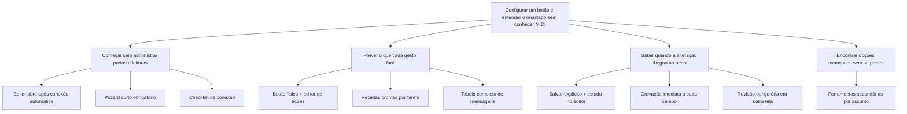
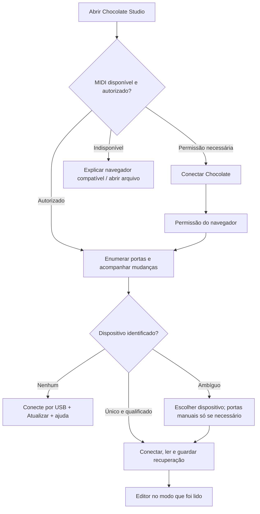
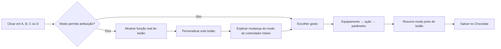
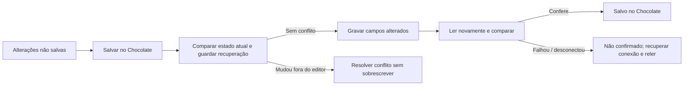

# Chocolate Studio: editor centrado no botão

Proposta de produto · 8 novembro 2026 · **implementação autorizada após explicitar as decisões de design**

## Decisão proposta

Abrir o Chocolate, escolher um botão, escolher o resultado e salvar. Uma única superfície de edição substitui o wizard obrigatório e a navegação por projetos. A ilustração física do controlador permanece. A biblioteca e as proteções de gravação permanecem; sua operação passa a ser responsabilidade do aplicativo, sem exigir que o usuário gerencie cada etapa.

Com a autorização posterior do usuário, esta proposta substitui as decisões de navegação de `guided-experience.md` e `operating-modes.md` que exigem confirmação manual de portas e uma tela obrigatória de modo antes de editar. Não altera seus contratos de preservação, identidade, capacidades e releitura. A versão publicada permanece intacta até integração e qualificação da nova implementação.

[Protótipo navegável](../../research/prototypes/ui-reset/index.html) · [Instruções de revisão](../../research/prototypes/ui-reset/README.md)

## 1. Problema observado

Evidência: relato direto do usuário e inspeção de `ConnectionStep.tsx`, `connection-controls.tsx`, `ModeStep.tsx`, `hardware-browser.ts` e `connection-backup.ts` da beta.5. Não foi realizado teste de usabilidade com uma amostra de usuários.

| O que acontece hoje | Custo para a pessoa | Decisão proposta |
| --- | --- | --- |
| Listas vazias antes de “buscar portas” | Parece que o pedal não existe | Descoberta automática quando autorizada; atualizar como ferramenta secundária |
| Entrada, saída e confirmação manual para o caminho comum | Exige conhecimento de roteamento | Identificar um dispositivo; portas individuais só para resolver ambiguidade |
| Conectar, ler, continuar, escolher modo, continuar | Muitos atos sem resultado musical | Conectar e abrir diretamente o estado lido |
| Estados internos e avisos competem com a tarefa | A pessoa não sabe o próximo passo | Um estado curto por vez, junto da ação correspondente |
| Campo cru de MIDI antes da intenção | Obriga a conhecer PC/CC e valores | Equipamento → ação → parâmetro; MIDI manual como alternativa explícita |
| “Projetos”, “pedalboard”, backups, idioma na área principal | Objetos que não correspondem ao pedal | Configurações e preferências em ferramentas secundárias |
| Muitos collapses e seções longas | Esconde relações e cria rolagem | Painel do botão selecionado, mostrando um gesto de cada vez |

O problema não se resolve apenas reduzindo espaçamento ou trocando cores. A estrutura atual segue operações internas da aplicação; a nova estrutura segue as decisões do músico.

## 2. Pesquisa comparativa

Pesquisa documental em fontes oficiais e inspeção de imagens públicas. Não equivale a operar os cinco produtos nem a validar suas capacidades em hardware. Fontes consultadas em 8 novembro 2026; imagens e versões dos manuais podem representar versões anteriores dos produtos.

| Editor | Evidência documental | O que aproveitar | O que não transportar |
| --- | --- | --- | --- |
| **Morningstar** | Abre em Edit Preset. Conexão e atualização de dispositivos são comandos distintos. Dicionário MIDI seleciona marca, modelo e função para preencher mensagens. Ações/gestos fazem parte da edição. | Objeto primeiro; catálogo de ações legíveis; gesto separado do comando. | Grade extensa de mensagens, terminologia especializada e muitas abas. Não atribuir seus limites ao Chocolate. |
| **Fractal FM3-Edit** | Visão do preset, edição por seleção e biblioteca reutilizável. A imagem oficial de FC Controllers mostra switches e parâmetros separados de TAP e HOLD. | Relação espacial entre botão selecionado e seus comportamentos. | Densidade de parâmetros ou metáfora de cadeia de áudio em um controlador MIDI. |
| **Neural DSP Cortex Control** | O fabricante descreve sincronização do estado do Quad Cortex na abertura. Seleção de elementos na grade leva à edição. Manual documenta reconexão/troca de dispositivo em certos cenários. | Retomar o objeto atual sem perguntar novamente todo o setup. | Trocar automaticamente o destino de alterações pendentes; prometer sincronismo em tempo real não validado no Chocolate. |
| **Line 6 HX Edit** | Command Center associa controladores físicos a comandos. Salvar preset no equipamento e exportar arquivo são operações distintas. | Clicar no controle → editar sua função; separar salvar no aparelho de guardar arquivo. | Janelas e menus técnicos em excesso, ou assumir que edições no Chocolate são aplicadas instantaneamente. |
| **BOSS Tone Studio** | A edição de som e o comando WRITE ocupam a área de edição; Librarian organiza cópias e LiveSets. | Gravação explícita em posição previsível; arquivos fora da tarefa principal. | Descoberta de conteúdo, marketing e biblioteca como entrada obrigatória. |

Fontes: [Morningstar — manual do editor](https://help.morningstar.io/en/article/morningstar-editor-user-manual-81kpjn/), [Fractal — FM3-Edit](https://www.fractalaudio.com/fm3-edit/), [Neural DSP — Cortex Control](https://neuraldsp.com/cortex-control), [manual Quad Cortex / Cortex Control](https://neuraldsp.com/manual/quad-cortex), [HX Edit 3.11 Pilot’s Guide](https://l6c-acdn2.line6.net/data/6/0a020a3f137e660b4f6a285cb7/application/pdf/HX%20Edit%203.%E2%80%8B11%20Pilot%27s%20Guide%20-%20English%20.pdf), [BOSS — Tone Studio e Katana](https://articles.boss.info/getting-started-boss-tone-studio-and-katana/).

**Inferência de produto:** esses exemplos sustentam uma interface baseada no objeto editado, com ferramentas auxiliares ao redor. Não demonstram que copiar sua aparência produziria uma boa experiência para iniciantes. Morningstar é a referência funcional mais próxima; a clareza desejada precisa superar sua densidade.

## 3. Resultado desejado e árvore de oportunidades

**Resultado:** alguém sem experiência em MIDI consegue configurar A para chamar um preset ao tocar, outro ao segurar, salvar no Chocolate e explicar o resultado sem ajuda.

Prioridade qualitativa: começar, entender o botão e compreender a gravação são urgentes, sustentadas pelo relato atual. Personalização visual, biblioteca comunitária e contas não atendem à dor imediata.

Alternativas avaliadas:

- **Editor direto + painel contextual (recomendado):** aproveita o modelo físico já compreendido e permite idas e voltas sem reiniciar um fluxo. Exige estados de conexão bem desenhados.
- **Wizard obrigatório mais curto:** reduz decisões por tela, mas ainda atrasa cada edição e dificulta voltar a apenas um campo. Contraria a experiência relatada.
- **Receitas como página inicial:** ajuda em tarefas comuns, mas esconde configurações já existentes e pode parecer que o produto serve só para certos equipamentos. Receitas podem entrar depois como ação opcional dentro do editor.
- **Tabela de todas as mensagens:** eficiente para especialistas; reproduz a principal barreira para iniciantes. Usar somente em uma ferramenta avançada, se houver necessidade real.

Experimentos antes da implementação: comparar editor direto com um storyboard de wizard curto; pedir a iniciantes que interpretem o resumo do botão; observar se distinguem alteração local de gravação. Medidas e critérios estão na seção 13. Não há pontuação quantitativa inventada nem validação concluída.

## 4. Arquitetura da experiência

**Área principal:** nome Chocolate Plus; estado de conexão; modo atual e Alterar; desenho A–D; resumo das ações; painel do botão selecionado; estado das alterações e Salvar no Chocolate.

**Ferramentas secundárias:** Configurações (abrir/baixar cópia/histórico); Ajustes do Chocolate (modo, canal, pedal externo e demais opções suportadas); Preferências (idioma); Ajuda de conexão. Não existe nome obrigatório de pedalboard ou projeto, nem sidebar de módulos vazios.

O equipamento de destino é contexto da ação, não identidade da aplicação. O modelo M5 fornece rótulos, limites, requisitos e tradução para mensagens. A estrutura permanece igual para outro perfil. Uma ação pode apontar para um destino diferente quando o controlador e seu roteamento permitirem; a UI não deve impor um único equipamento global artificialmente.

## 5. Fluxo de entrada

Após permissão previamente concedida, carregamento inicial automático e reação a `statechange`. Se o navegador exigir interação/permissão, **um** botão significativo inicia o acesso. Nunca mostrar selects vazios sem dizer se estamos buscando, aguardando permissão ou sem dispositivo.

O app tenta o par conhecido/recordado, qualifica a identidade e lê a configuração completa. Um nome como SINCO não comprova identidade. Não enviar SysEx do fabricante indiscriminadamente a todas as saídas. Emparelhamento ambíguo exige escolha; o caminho normal não exige checkbox de confirmação. Recordar portas não autoriza gravar nem trocar de controlador automaticamente.

A possibilidade técnica de enumerar portas e acompanhar conexões é documentada em [MDN requestMIDIAccess](https://developer.mozilla.org/en-US/docs/Web/API/Navigator/requestMIDIAccess) e [MIDIAccess statechange](https://developer.mozilla.org/en-US/docs/Web/API/MIDIAccess/statechange_event). HTTPS e permissão de SysEx continuam necessários. A qualidade do pareamento entre plataformas requer uma investigação curta; não está pronta por existir uma maquete.

## 6. Fluxo de editar um botão

Exemplo de template: **Ao tocar → Line 6 M5 → Selecionar preset → 1**. Ao segurar usa o mesmo vocabulário, com preset 2. O resumo diz **Toque: Preset 1 · Segure: Preset 2**. PC 0/1 aparece apenas em “Ver MIDI”.

Formulários alteram a edição local ao receber valores válidos; não há um segundo botão “Aplicar ao rascunho”. Valores incompletos permanecem visíveis com erro de campo e impedem salvar. Trocar de botão não perde o formulário. Desfazer precisa estar disponível. Adicionar uma segunda mensagem é opção avançada, sem expor uma grade vazia ao iniciante.

Gesto e comportamento devem obedecer ao layout qualificado. “Toque/segurar”, alternância entre toques, momentâneo e sequências não são equivalentes. A renderização adapta os nomes e as quantidades de ações ao comportamento real. A maquete detalha toque/segurar; a implementação não deve oferecer combinações livres que o firmware não armazena.

## 7. Modo de operação sem uma nova barreira

O modo lido é visível na barra do controlador. Não se pergunta novamente em cada abertura. **Alterar** mostra uma escolha por intenção, com nome técnico secundário para comparação com CubeSuite. Mudanças ficam locais até salvar.

| Modo existente | Como apresentar / editar |
| --- | --- |
| Program change A | Presets em sequência. A–D mostram números 000–003, 004–007 etc.; canal e intervalo editáveis. Não há 128 ações livres. |
| Program change B | Controles MIDI em sequência. Mostrar CC fixo e valor conforme o layout observado; canal e intervalo. |
| Custom mode | Quatro comandos personalizados. Editor específico dos campos que esse modo armazena. |
| Advanced custom mode | Ações MIDI personalizadas. Grupos e comportamentos suportados; toque/segurar e sequências quando qualificados. |
| Manufacturer control | Controle M-VAVE. Explicar escopo observado sem prometer todos os produtos da marca. |
| Touch screen (Android) | Gestos no Android. Mostrar as quatro funções fixas e conexão necessária. |
| Video Model | Controles de vídeo. Funções fixas legíveis no desenho. |
| Keyboard A | Setas do teclado. Mostrar ↑ ↓ ← →. |
| Keyboard B | Navegação. Mostrar Page Up, Page Down, espaço e Enter. |
| MultiMedia keyboard | Mídia. Mostrar faixas e volume correspondentes. |
| Custom keyboard mode | Atalhos personalizados. Editor de tecla/modificadores por grupo. Não mostrar equipamento MIDI. |
| Mix key | MIDI e teclado. Tipo de função por botão determina o painel correto. |
| Speaker mode | Controle de caixa. Expor somente opções observadas e explicar a função fixa. |

Todos os treze modos continuam acessíveis. Os mais comuns aparecem primeiro, os demais agrupados em “Outros usos”, sem seleção automática de Advanced como fallback. Valores desconhecidos aparecem como desconhecidos e são preservados.

**Sequencial:** o intervalo é o modelo principal. E=A+B volta, F=C+D avança nesse modo. No editor, avançar a visualização não é pressionar o pedal nem mudar o visor físico. Mostrar “Visualização 004–007”; a escolha A corresponde a 004. Limites 000–127 são 128 posições, não 000–128. A tradução de um PC para preset só aparece dentro do intervalo documentado pelo perfil (M5: 24 presets).

**Personalizável:** grupos seguem o layout observado, não os 128 números do modo PC. Não atribuir navegação E/F a outros modos sem evidência. Ao sair do modo fixo, explicar uma vez que a mudança afeta A–D e a navegação do controlador inteiro; não criar a falsa impressão de mudar apenas A. Dados inativos preservados não devem ser reescritos por uma troca de modo isolada.

## 8. Uma gravação compreensível

Salvar permanece na mesma posição, desabilitado sem alterações ou durante uma operação. Estado curto e específico: “2 botões alterados”, “Salvando…”, “Salvo no Chocolate”. O resumo de mudanças é acessível por “Ver alterações”; não obriga outra página para toda edição.

Confirmação contextual para mudança de modo, importação em massa ou restauração; nunca duas confirmações repetindo a mesma decisão. A confirmação deve acontecer sobre a alteração concreta e ainda válida. O protótipo explica a troca de modo ao escolhê-la e mantém a mudança visível até salvar; a implementação deve invalidar esse aceite se o impacto mudar.

Identidade, backup, comparação completa, preservação de bytes não editados, ACK e releitura exata continuam obrigatórios. São execução interna, não um checklist manual. Se a cópia local falhar, a exceção aparece só ao tentar salvar, com alternativa clara de baixar a cópia. Não impedir leitura/edição por falha de armazenamento.

“Salvo” confirma a configuração no Chocolate, não o som produzido pelo M5 ou outro destino. A conferência física é uma ação opcional contextual depois de salvar. Nenhum botão de teste deve enviar mensagens ao equipamento sem deixar explícito o que enviará e por qual rota.

## 9. Estados e recuperação

| Estado | Interface / próxima ação |
| --- | --- |
| Buscando / lendo | Progresso no lugar da conexão; desenho não editável até haver configuração válida |
| Sem permissão | Conectar Chocolate; se negada, instrução específica para permissão e tentar novamente |
| Sem dispositivo | Conecte por USB; Atualizar; ajuda de cabo/porta |
| Duas opções possíveis | Lista de dispositivos; detalhes de entrada/saída quando necessário, sem checkbox genérico |
| Firmware ou identidade desconhecidos | Identificação encontrada e motivo da incompatibilidade; nenhuma falsa edição suportada |
| Configuração incompleta | Tentar ler novamente; não preencher lacunas com defaults |
| Desconectado com edição | Manter edição; reconectar e verificar identidade/baseline antes de salvar |
| Edição local recuperada | Informar que há alterações anteriores; oferecer retomar ou usar configuração lida, sem descarte silencioso |
| Conflito externo | Mostrar diferença e escolher recarregar ou reaplicar mudanças compatíveis sobre nova leitura; nunca sobrescrever automaticamente |
| Falha ao gravar | Não exibir sucesso; reler para saber o que chegou ao controlador e permitir recuperação |
| Navegador sem MIDI | Explicar compatibilidade; abrir configuração para edição offline claramente identificada |
| Arquivo inválido | Erro compreensível e localização útil; estado atual intacto |

## 10. Configurações, equipamentos e idioma

“Arquivo” abre uma área secundária: **Baixar uma cópia**, **Abrir configuração**, **Histórico de recuperação**. Nenhuma ação grava no pedal implicitamente. Importar mostra resumo e compatibilidade antes de substituir a edição local. Arquivo de configuração do Studio preserva os metadados; cópia bruta FCP e restauração têm função e validação próprias, não são formatos intercambiáveis.

Nome de arquivo sugerido automaticamente, editável no momento de exportar. Não obrigar nome de projeto. Cópias automáticas são identificadas por data e dispositivo, não por hashes na experiência comum. Manter dados somente no cliente; nenhuma conta, telemetria ou upload implícito.

Equipamentos ficam num catálogo declarativo versionado, reaproveitando o modelo atual: identificação, traduções, ações, parâmetros, transformações MIDI, requisitos, fonte e status de verificação. A UI genérica renderiza pelo schema. Canal é configuração explícita do destino, nunca “detectado” por default. Ajuda do template explica onde ajustar o receptor. Um perfil não cria capacidade no Chocolate; filtrar pela interseção real de capacidades.

M5 é o primeiro perfil documentado. TONEX e Quad Cortex entram quando houver catálogo fundamentado e validação; não mostrar opções ativas fictícias. Nomes de timbres de outro aparelho não são detectados pelo simples recebimento de PC. Nomes adicionados pelo usuário são referências locais.

Idioma acompanha preferência persistida ou navegador, com fallback definido. Troca direta de idioma no cabeçalho, sem perder edição nem reconectar. Exemplos de copy:

| Português | English |
| --- | --- |
| Conectar Chocolate | Connect Chocolate |
| Atualizar dispositivos | Refresh devices |
| Ao tocar / Ao segurar | On tap / On hold |
| O que este botão faz? | What does this switch do? |
| Equipamento / Ação | Device / Action |
| Salvar no Chocolate | Save to Chocolate |
| Alterações não salvas | Unsaved changes |
| Salvo no Chocolate | Saved to Chocolate |
| Personalizar este botão | Customize this switch |
| Baixar uma cópia | Download a copy |

## 11. Layout e acessibilidade

Desktop: barra compacta, controlador e resumos à esquerda, painel do botão à direita. Tablet e celular: controlador, resumo selecionado e editor em coluna. Salvar continua encontrável sem cobrir o último campo. O teclado virtual e zoom não podem esconder erros ou ações.

Preservar a geometria A–B / visor / C–D, inclusive quando estreita. Em telas pequenas a ilustração pode reduzir, mas os alvos clicáveis permanecem de pelo menos 44×44 CSS px. Os resumos têm seleção alternativa acessível. Nenhuma informação depende de hover, cor ou animação.

Rótulos permanentes; foco visível; ordem de leitura consistente; sem scroll horizontal da página em 320px; contraste AA; diálogos com foco contido e retorno ao acionador; Escape fecha; seleção anunciada por estado acessível; progresso por live region moderada. Preferir controles nativos e respeitar redução de movimento. Testar nomes longos, erros, português/inglês e zoom 200%, não apenas screenshot vazio.

A estética é hipótese para revisão: superfície clara, controlador escuro, foco âmbar e pouco ruído. Não usar slogans, grandes chamadas ou cartões de marketing. A ilustração aprovada na aplicação deverá ser reaproveitada; a maquete apenas representa seu lugar e interação.

## 12. Escopo técnico para uma implementação futura

Manter stack, SDK, codecs, perfis e validações. Construir uma nova camada de experiência com estados explícitos de conexão, edição, gravação e recuperação. Separar persistência local de gravação no dispositivo sem expor essa separação como objetos que o iniciante precisa administrar.

Investigações necessárias: pareamento confiável em diferentes sistemas e dispositivos com nomes iguais; política de permissão do navegador; reconexão com edição pendente; capacidade real de cada gesto por modo; modelo de grupos em cada modo; apresentação de todos os ajustes mapeados sem virar um formulário único. Não declarar essas questões resolvidas pelo desenho.

A migração deve manter import/export existentes, preservação de dados e recuperação; criar nova UI em caminho isolado e comparável antes de substituir a publicada. Entregar primeiro o fluxo comum completo, depois validar os treze modos, os estados excepcionais e os idiomas. Qualificação do SDK não substitui teste de usabilidade.

## 13. Critérios de decisão e validação

Metas propostas, ainda não medidas:

1. Retorno com permissão e dispositivo qualificado único: abrir o editor sem clicar em buscar/ler/continuar.
2. Primeira utilização: uma ação do app para conectar, além da permissão do navegador quando exigida; nenhuma confirmação genérica de portas.
3. Pelo menos 4 de 5 iniciantes completam toque preset 1 / segurar preset 2 e salvar em até 3 minutos, sem instrução de PC/CC. O tempo começa com uma conexão disponível, para separar cabos/driver de clareza do editor.
4. Os cinco identificam corretamente o botão/gesto alterado e se a mudança já está salva no controlador. Nenhuma gravação acidental durante navegação ou seleção de modo.
5. Todos localizam mudar modo e baixar cópia sem ajuda; registrar tempo e hesitações, não presumir sucesso.
6. Tarefas completas por teclado, layouts 320/390/830/1280px, zoom 200%, rótulos longos PT/EN, ausência de sobreposição e rolagem horizontal involuntária.
7. Regressão funcional: todos os treze modos, preservação de campos inativos, importação, conflito, cancelamento, desconexão, backup indisponível e releitura divergente.

Roteiro: (a) explicar o que vê na primeira abertura; (b) configurar A; (c) explicar B sem abri-lo; (d) salvar; (e) desligar e retomar; (f) trocar modo sabendo o impacto; (g) baixar cópia. O moderador não explica MIDI nem aponta botões. Observar a pessoa, registrar erros e revisar o desenho antes do desenvolvimento.

## 14. O que está pronto para revisão

Protótipo navegável em português com editor principal, conexão simulada, preset sequencial, mudança contextual para ações personalizadas, toque/segurar, equipamento genérico/M5, salvamento simulado, arquivos e alguns estados de falha. Fluxos e pesquisa acessíveis na própria página.

Não é uma implementação funcional de MIDI, catálogo completo de todos os modos, tradução completa nem prova de usabilidade. A próxima decisão é validar o modelo de interação e a hierarquia; após isso, detalhar os painéis restantes e implementar. Nenhum arquivo da aplicação ou release foi modificado nesta etapa.

## Apêndice A — composição dos painéis por família

Este inventário impede que o redesenho volte a atender apenas Advanced. Os valores e limites vêm do [mapeamento próprio](../../packages/chocolate-layout/MAPPING.md); estes são contratos de desenho, não novos resultados de verificação física.

| Família | Conteúdo do painel ao selecionar A–D | Navegação / detalhes |
| --- | --- | --- |
| PC / CC sequencial | Função fixa, número real enviado, interpretação opcional pelo perfil e ação “Personalizar este botão”. | Intervalos de quatro posições. Ajustar último intervalo nos ajustes do modo. M5 não deve aparecer como detectado ou selecionado por padrão num dispositivo real sem vínculo anterior. |
| Custom mode | Seletor de comando por botão usando a lista observada; opção associada de visualização apenas com a semântica comprovada. | Não confundir o índice do seletor com o número CC enviado. Não oferecer toque/segurar se esse modo não o armazena. |
| Advanced | Cabeçalho do botão; comportamento; ações correspondentes; equipamento, ação e parâmetros. Comportamento padrão segue a configuração lida, nunca a preferência do editor. | Oito grupos armazenados. Dentro de cada sequência, primeiro mostrar a ação existente; “Adicionar ação” só quando solicitado. Preservar slots e comandos desconhecidos, sem compactar ao reorganizar a apresentação. |
| Keyboard A/B, mídia, Android e vídeo | Ilustração e descrição da função fixa. Explicar a rota necessária e oferecer “Personalizar atalhos” somente com transição de modo clara. | Não exibir seletor de equipamento MIDI nem tabs de gesto fictícias. |
| Custom keyboard | Tecla principal, até dois modificadores suportados, preview legível como “Ctrl + Shift + P”. | Seis grupos. Rejeitar modificador duplicado. Usar seleção de teclas; captura de atalho, se adicionada depois, não pode disparar atalhos destrutivos do navegador. |
| Mix | Primeira escolha: “Ação MIDI”, “Atalho de teclado” ou “Navegação e mídia”. Em seguida, reutilizar somente o editor correspondente. | Seis grupos próprios. Não reutilizar os oito grupos Advanced como se fossem a mesma memória. Trocar de função preserva dados inativos; os comandos de navegação usam a lista observada do campo Turner. |
| Manufacturer / Speaker | Resumo da função embutida e ajustes globais aplicáveis. | Não mostrar campos desabilitados de outra família como se fossem configuração incompleta. Escopo de compatibilidade deve ser explícito. |

**Comportamentos Advanced/Mix:** uma ação; alternar duas ações em toques sucessivos; pressionar/soltar; segurar; tocar/segurar. O vocabulário da UI descreve o gesto, mas os tempos, repetições e eventos físicos não podem ser inventados a partir do rótulo de armazenamento. Quando falta qualificação de comportamento, informar isso no detalhe correspondente. Não colocar um banner genérico em todos os botões.

**Ajustes do Chocolate, por assunto:**

- **Funcionamento:** modo e limites da família atual. Diferenciar mudar qual grupo está sendo visualizado no editor de gravar uma seleção de grupo no controlador; esta última precisa de intenção explícita.
- **Conexões:** canal global onde aplicável; conector externo configurado como expressão ou TRS-MIDI. O canal de uma mensagem Advanced/Mix pertence à própria mensagem, não é sobrescrito por um canal global arbitrário.
- **Expressão:** comandos e extremos suportados pela representação real da interface externa. Não reutilizar o editor de slots MIDI comuns: esse banco tem representação própria. Mostrar polaridade apenas com uma explicação sustentada pela observação.
- **Visor e compatibilidade:** opções PC display, Visual A–D e Bank MIDI, com rótulo de origem e limite da evidência quando o significado físico não foi qualificado. A existência de um campo gravável não autoriza inventar um benefício para ele.
- **Informações técnicas:** identificação, versão e detalhes de porta. Diagnóstico de tráfego separado do editor comum.

A implementação precisa de uma checklist de cobertura que relacione cada campo já suportado ao seu painel. Nenhum campo desaparece por não caber na tela inicial; tampouco todo campo precisa aparecer ao editar um preset.

## Decisão de implementação após revisão do cabeçalho

O usuário rejeitou Configurações + Ajustes + engrenagem como três sinônimos e autorizou implementar desde que cada escolha tenha um motivo e a hierarquia seja coerente. A solução não é esconder idioma junto de arquivos: idioma fica diretamente acessível no topo. O registro normativo de cada escolha, sua localização, motivo e critério está em [.interface-design/system.md](../../.interface-design/system.md).

Hierarquia final: **aplicativo** (idioma e arquivo), **controlador** (conexão, modo e interface externa), **botão/gesto** (destino, canal e ação), **gravação** (um comando persistente). Opções de escopos diferentes não são agrupadas somente porque todas são chamadas de configuração.

A pesquisa e a maquete anteriores são material de decisão. A implementação não está obrigada a preservar controles rejeitados da maquete. Manter todos os recursos suportados; reconstruir a composição, a conexão e os caminhos de edição. Testar regressão de dados e o fluxo completo antes de publicar.
